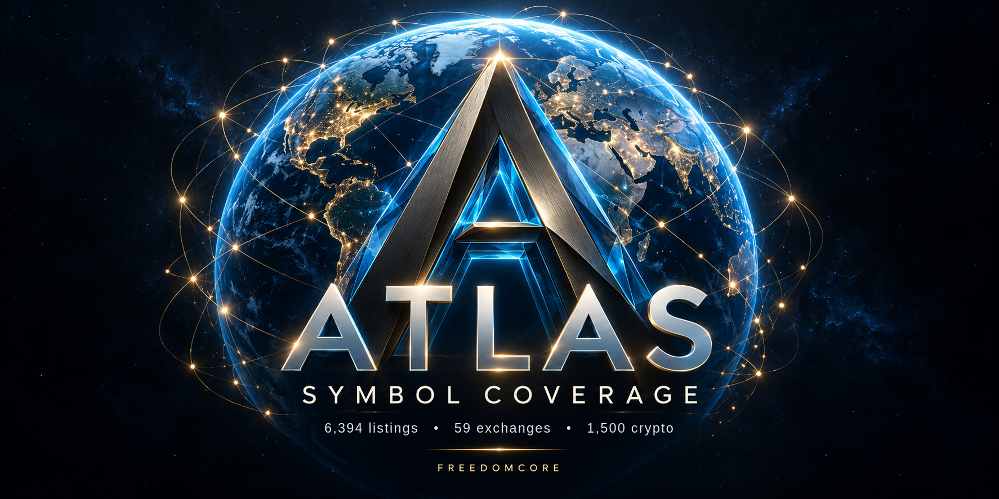

  

# FreedomCore Atlas Open Datasets (CC BY 4.0)

I started publishing this register because joining market data on bare tickers quietly breaks things. "SOL" is Solana, but it's also four different listed companies. Every row here is keyed to one exact listing, so a join on the key can't silently merge them. Some listings are still waiting on source records, and each row's record_state says so. If you spot something wrong, open an issue and I'll look into it. Rob, FreedomCore.

Public, machine-readable reference datasets published by **[FreedomCore Atlas](https://atlas.freedomcore.io/)** for cross-border financial entity resolution, source-dated market developments and platform security verification.

> **Current release in this repository:** `atlas-symbol-coverage` **v4** (`atlas.symbol_coverage.v4`), **6,394** listings (4,875 equities, 1,500 crypto assets, plus indices, commodities and FX) across 69 venues, checked `2026-11-05T21:37Z`. It refreshes daily, together with the [Hugging Face](https://huggingface.co/datasets/freedomcoreai/atlas-symbol-coverage) and [Kaggle](https://www.kaggle.com/datasets/atlasfreedomcoreio/atlas-symbol-coverage) mirrors.

---

## 1. Canonical web entry points

| Surface | Canonical URL | Scope |
| :-- | :-- | :-- |
| Atlas homepage | [`https://atlas.freedomcore.io/`](https://atlas.freedomcore.io/) | Global market overview and dated observations |
| Public data catalog | [`/datasets/`](https://atlas.freedomcore.io/datasets/) | `schema.org/DataCatalog` index, CSV/JSON downloads |
| Symbol Coverage dataset page | [`/datasets/atlas-symbol-coverage/`](https://atlas.freedomcore.io/datasets/atlas-symbol-coverage/) | Canonical page for the files in this repository |
| Realm directory | [`/stocks/`](https://atlas.freedomcore.io/stocks/) | 6,375 company and crypto listings; equities across 53 countries |
| Research Centre | [`/workstation/`](https://atlas.freedomcore.io/workstation/) | Interactive research desk with source citations |
| Atlas Quakes | [`/quakes/`](https://atlas.freedomcore.io/quakes/) | Source-dated company and protocol developments (successor to Market Pulse) |
| Atlas Studio | [`/studio/`](https://atlas.freedomcore.io/studio/) | Audio briefings and recorded market observations |
| Daily Notes | [`/notes/daily/`](https://atlas.freedomcore.io/notes/daily/) | Receipt-bound public research editions |
| Methodology | [`/methodology/`](https://atlas.freedomcore.io/methodology/) | Source admission rules, clock separation, non-fabrication boundary |
| Security and trust | [`/security/`](https://atlas.freedomcore.io/security/) | Public controls and reproducible proof |

---

## 2. Dataset families and official mirrors

| Family | Canonical Atlas route | Hugging Face | Kaggle | Status in this repository |
| :-- | :-- | :-- | :-- | :-- |
| **Symbol Coverage** (`atlas-symbol-coverage`) | [`/datasets/atlas-symbol-coverage/`](https://atlas.freedomcore.io/datasets/atlas-symbol-coverage/) | [`freedomcoreai/atlas-symbol-coverage`](https://huggingface.co/datasets/freedomcoreai/atlas-symbol-coverage) | [`atlasfreedomcoreio/atlas-symbol-coverage`](https://www.kaggle.com/datasets/atlasfreedomcoreio/atlas-symbol-coverage) | **v4** (6,394 rows, refreshed daily, digests below) |
| **Market Pulse** (`atlas-market-pulse`) | [`/datasets/atlas-market-pulse/`](https://atlas.freedomcore.io/datasets/atlas-market-pulse/) | [`freedomcoreai/atlas-market-pulse`](https://huggingface.co/datasets/freedomcoreai/atlas-market-pulse) | Removed | **Retired product.** Files here are the retained 2026-07-20 snapshot, unchanged. Live successor: [Atlas Quakes](https://atlas.freedomcore.io/quakes/) |
| **Security Posture** (`atlas-security-posture`) | [`/datasets/atlas-security-posture/`](https://atlas.freedomcore.io/datasets/atlas-security-posture/) | [`freedomcoreai/atlas-security-posture`](https://huggingface.co/datasets/freedomcoreai/atlas-security-posture) | [`atlasfreedomcoreio/atlas-security-posture`](https://www.kaggle.com/datasets/atlasfreedomcoreio/atlas-security-posture) | Retained 2026-07-20 snapshot, unchanged. Current controls: [`/security/`](https://atlas.freedomcore.io/security/) |

Mirror revisions are managed per platform and can lag this repository. The canonical Atlas dataset pages state the current revision for each platform.

---

## 3. Symbol Coverage v4 files and digests

| File | Bytes | SHA-256 | Description |
| :-- | --: | :-- | :-- |
| `atlas-symbol-coverage/atlas-symbol-coverage.csv` | 2,653,433 | `2c31eca76d926f7691eb3cd9d61231474bba2e2acfdc24297ecdb2c85c27ba33` | Full 6,394-row CSV register (25 columns, `atlas.symbol_coverage.v4`) |
| `atlas-symbol-coverage/atlas-symbol-coverage.json` | 5,371,122 | `081642ba2bee9c4a0f8b4b04dd7d59632a9ac31c6f1d99a9d685bc3490807b78` | Full 6,394-record JSON register |
| `atlas-symbol-coverage/schema.json` | 3,720 | `8a69589461dc00b4e914e44c13d725ebb600647b5d609c4f1695dd44b01dd33f` | Machine-readable 25-column v4 schema |
| `atlas-symbol-coverage/atlas-symbol-coverage-summary.json` | 1,314 | `8c1a69f0514fca54bd09189851aed79198436cfa7f05627a18a58ad3ad564081` | Counts for this release (quote, profile, research and chart layers) |

Columns (`25`): `listing_key`, `ticker`, `name`, `asset_class`, `exchange`, `country_code`, `route_slug`, `profile_url`, `workstation_url`, `sec_cik`, `coingecko_id`, `profile_state`, `profile_as_of`, `research_state`, `research_as_of`, `quote_state`, `quote_observed_at`, `chart_bars`, `checked_at`, `record_exists`, `record_state`, `record_checked_at`, `record_sha256`, `stored_source_count`, `dated_source_count`.

`listing_key` is the primary key: `EXCHANGE:TICKER` for equities, `CRYPTO:SYMBOL` or `COINGECKO:ID` for digital assets. `quote_state` says whether the price is live for that exchange's session (`live`), stored but awaiting a fresh accepted capture, stale, or held because the venue calendar isn't certified yet. `record_*` columns are carried from v3 with their original 23-25 October dates.

---

## 4. Why exact `listing_key` disambiguation matters (330 colliding bare-ticker groups)

Joining global datasets on bare ticker strings corrupts cross-border equity and crypto data. Across the 6,375 company and crypto listings in this register, **330 bare tickers collide across 722 distinct listings.** Every record is keyed by its exact `listing_key` and canonical profile route:

| Bare ticker | Canonical `listing_key` | Instrument | Class | Country | Canonical profile route | `quote_state` |
| :-- | :-- | :-- | :-- | :-- | :-- | :-- |
| `SOL` | `CRYPTO:SOL` | Solana | `crypto` | `GL` | [`/stocks/SOL/`](https://atlas.freedomcore.io/stocks/SOL/) | `live` |
| `SOL` | `ASX:SOL` | Washington H. Soul Pattinson and Company Limited | `equity` | `AU` | [`/stocks/asx-sol/`](https://atlas.freedomcore.io/stocks/asx-sol/) | `live` |
| `SOL` | `BME:SOL` | Soltec Power Holdings SA | `equity` | `ES` | [`/stocks/bme-sol/`](https://atlas.freedomcore.io/stocks/bme-sol/) | `live` |
| `SOL` | `JSE:SOL` | Sasol Limited | `equity` | `ZA` | [`/stocks/jse-sol/`](https://atlas.freedomcore.io/stocks/jse-sol/) | `live` |
| `SOL` | `MIL:SOL` | SOL S.p.A. | `equity` | `IT` | [`/stocks/mil-sol/`](https://atlas.freedomcore.io/stocks/mil-sol/) | `live` |
| `ARB` | `CRYPTO:ARB` | Arbitrum | `crypto` | `GL` | [`/stocks/ARB/`](https://atlas.freedomcore.io/stocks/ARB/) | `live` |
| `ARB` | `NZX:ARB` | ArborGen Holdings Limited | `equity` | `NZ` | [`/stocks/nzx-arb/`](https://atlas.freedomcore.io/stocks/nzx-arb/) | `stale_receipt` |
| `BCH` | `CRYPTO:BCH` | Bitcoin Cash | `crypto` | `GL` | [`/stocks/BCH/`](https://atlas.freedomcore.io/stocks/BCH/) | `live` |
| `BCH` | `SET:BCH` | Bangkok Chain Hospital Public Co., Ltd. | `equity` | `TH` | [`/stocks/set-bch/`](https://atlas.freedomcore.io/stocks/set-bch/) | `live` |
| `LDO` | `COINGECKO:lido-dao` | Lido DAO | `crypto` | `GL` | [`/stocks/cg-lido-dao/`](https://atlas.freedomcore.io/stocks/cg-lido-dao/) | `live` |
| `LDO` | `MIL:LDO` | Leonardo SpA | `equity` | `IT` | [`/stocks/mil-ldo/`](https://atlas.freedomcore.io/stocks/mil-ldo/) | `live` |
| `1810` | `HKEX:1810` | Xiaomi Corporation Class B | `equity` | `HK` | [`/stocks/hkex-1810/`](https://atlas.freedomcore.io/stocks/hkex-1810/) | `live` |
| `1810` | `TADAWUL:1810` | Seera Holding Group | `equity` | `SA` | [`/stocks/tadawul-1810/`](https://atlas.freedomcore.io/stocks/tadawul-1810/) | `live` |
| `7203` | `TADAWUL:7203` | Elm Company | `equity` | `SA` | [`/stocks/tadawul-7203/`](https://atlas.freedomcore.io/stocks/tadawul-7203/) | `live` |
| `7203` | `TSE:7203` | Toyota | `equity` | `JP` | [`/stocks/7203/`](https://atlas.freedomcore.io/stocks/7203/) | `live` |

---

## 5. Coverage in this release (2026-11-05)

| Metric | Value | Note |
| :-- | --: | :-- |
| Listings | 6,394 | 4,875 equities, 1,500 crypto, 8 indices, 8 commodities, 3 FX |
| Venues | 69 | exchanges plus crypto namespaces |
| Live price | 4,652 | current for the listing's exchange session |
| Stored price awaiting fresh capture | 1,407 | |
| Valid price held (calendar not certified) | 16 | |
| Stale / none collected / source conflict | 316 / 2 / 1 | |
| Verified profile text | 6,066 | |
| Research report observed | 5,142 | |
| Chart renderable | 4,851 | listings with daily bars |

Counts are computed from the files in this repository. Unknown never means delisted, and prices that fail a check are held rather than guessed.

---

## 6. Provenance and licence

All files are published by FreedomCore Atlas and derived from https://atlas.freedomcore.io. Each row maps to a real, indexable Atlas page. This is research metadata: not financial advice, not signals, not brokerage execution.

Released under **[Creative Commons Attribution 4.0 International (CC BY 4.0)](https://creativecommons.org/licenses/by/4.0/)**. Reuse, including commercial reuse, is permitted with attribution to **FreedomCore Atlas** and a link to https://atlas.freedomcore.io/. See [LICENSE](LICENSE). Contains public identity and provenance metadata only: no paid research prose, no third-party article bodies, no subscriber data.

Contact: freedomcoreai@gmail.com
